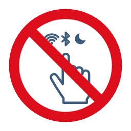
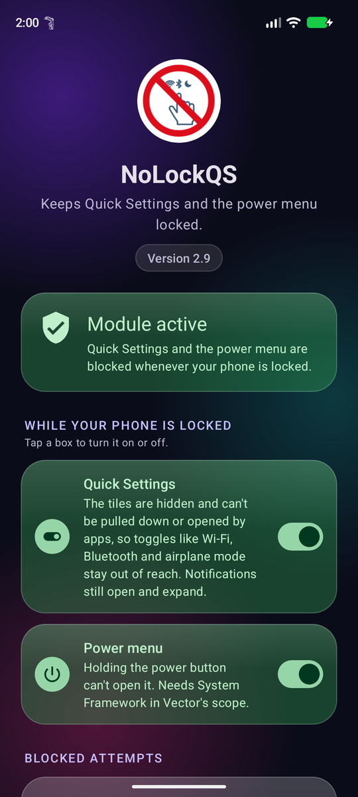
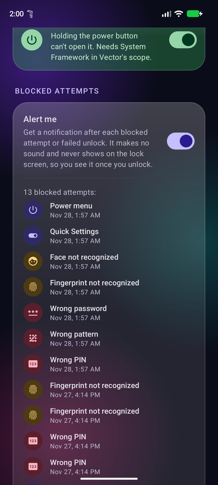
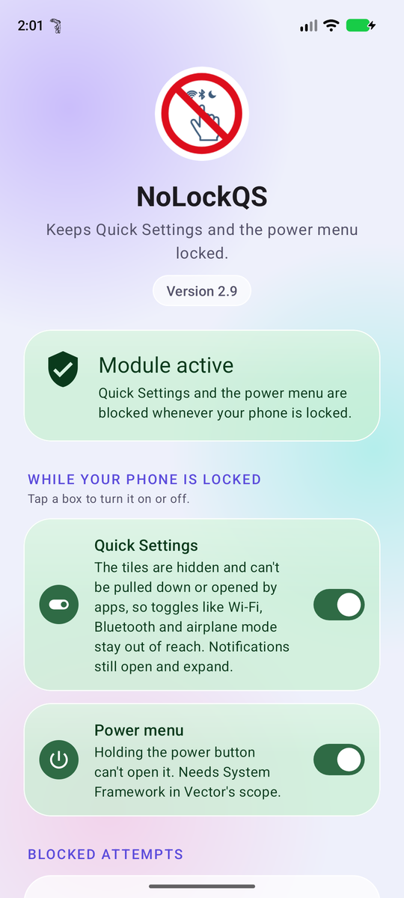
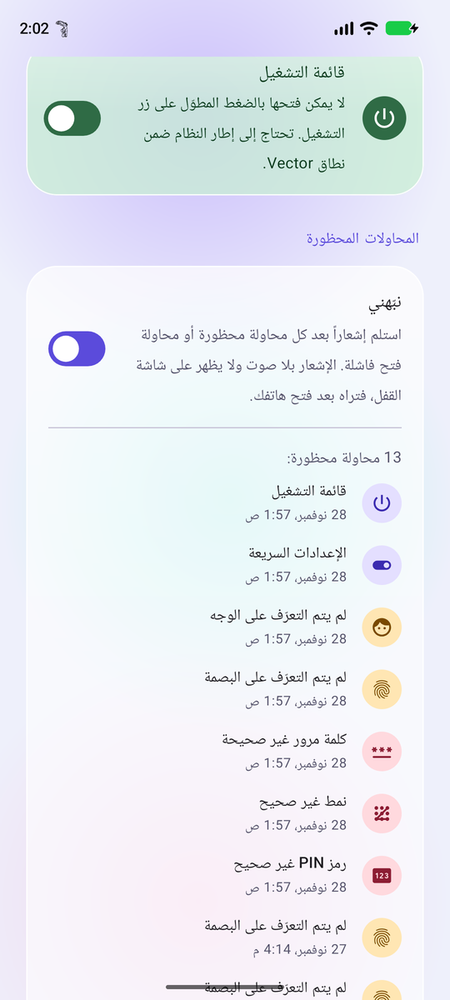

  <b>العربية</b> · <a href="README.md">English</a> · <a href="README.zh-CN.md">简体中文</a>

# مشروع NoLockQS 🔐🚫

**الهاتف المقفل يجب أن يبقى مقفلًا.** 
يخفي NoLockQS الإعدادات السريعة وقائمة التشغيل على شاشة القفل، ويخبرك حين يحاول أحدهم الوصول إليها. 🕵️

 

&nbsp;
&nbsp;
&nbsp;

## 🤔 لماذا

يخطف اللصوص الهاتف المقفل ويتجهون مباشرة إلى لوحة السحب للأسفل: تشغيل وضع الطيران، وإيقاف البيانات، وإطفاء الهاتف، ثم يختفون. يغلق NoLockQS هذه الأبواب ما دام الهاتف مقفلًا، ويترك كل ما عداها على حاله.

## ✨ ما الذي تحصل عليه

| | |
|---|---|
| 🧱 **لا إعدادات سريعة أثناء القفل** | لا مربعات ولا مفاتيح تبديل. وتبقى الإشعارات قابلة للفتح والتوسيع. |
| ⏻ **لا قائمة تشغيل أثناء القفل** | لا يمكن إطفاء الهاتف أو إعادة تشغيله من شاشة القفل. |
| ⚡ **فتح فوري** | يعود كل شيء لحظة فتح القفل، ويُقفل من جديد بالسرعة نفسها. |
| 🔔 **تنبيهات وسجل** | اطّلع على كل محاولة محظورة مع وقتها. ينتظر التنبيه الصامت حتى تفتح *أنت* القفل، فلا يُنبَّه اللص أبدًا. |
| 🕵️ **ومحاولات الفتح الفاشلة أيضًا** | رمز PIN خاطئ 🔢، أو نمط، أو كلمة مرور 🔑، أو بصمة 👆، أو وجه 🙂، ولكل منها أيقونة ملوّنة خاصة. لا يُحفظ إلا الوقت والنوع، ولا يُحفظ أبدًا ما أُدخل. |
| 🫧 **تصميم زجاجي** | بطاقات زجاجية شبه شفافة فوق ألوان ناعمة متوهجة. ✨ |
| 🌓 **فاتح أو داكن أو مثل الجهاز** | بضغطة واحدة، ويُطبَّق فورًا. |
| 🌍 **English · العربية · 简体中文** | عربية كاملة من اليمين إلى اليسار، إضافة إلى الصينية المبسطة. |
| 🩺 **تشخيص بضغطة واحدة** | تقرير جاهز للمشاركة حين يحدث خلل. |
| 🔒 **خصوصية** | لا إذن بالوصول إلى الإنترنت، ولا تتبع. كل شيء يبقى على هاتفك. |

## 📋 المتطلبات

- 📱 هاتف بصلاحيات الروت يعمل بنظام Android 15 أو أحدث (مُختبر على Android 15-17): هاتف Pixel، أو ROM بواجهة نظام (System UI) قريبة من الأصلية (AOSP)
- 🚀 Vector 2.2 أو أحدث

> **❗ مهم**
>
> يحتاج **Android 17** إلى Magisk 31.0 أو أحدث، وإصدار canary من Vector (3112 أو أحدث). لا يحمّل Magisk 30.7 ولا Vector 2.2 المستقر الوحدات على Android 17.

### 🧩 أنظمة ROM أخرى

يعمل NoLockQS على واجهة النظام الأصلية (AOSP)، لذا كلما كان الـ ROM أقرب إلى الأصل، كانت النتيجة أفضل.

| الحالة | أنظمة ROM | ملاحظات |
|:---:|---|---|
| ✅ **مُختبر** |  | هاتف Pixel على Android 17، ومحاكيات Android 15 و16 و17 |
| 🟡 **يُفترض أن يعمل** |     | شيفرة واجهة النظام نفسها الموجودة في Android الأصلي، ولم يُختبر بعد على جهاز حقيقي |
| ❌ **غير مدعوم** |      | تستبدل لوحة الإعدادات السريعة بلوحتها الخاصة، والأرجح أن NoLockQS لا يصل إليها |

لا تستخدم Pixel؟ اقفل الهاتف وجرّب السحب للأسفل. إن فُتحت اللوحة، فأرسل **تقرير التشخيص**.

## 🚀 التثبيت

1. نزّل ملف APK من [أحدث إصدار](https://github.com/Xposed-Modules-Repo/io.github.i2B4G10.NoLockQS/releases/latest) وثبّته.
2. افتح Vector، وفعّل **NoLockQS**، وحدّد النطاق الذي يطلبه: **واجهة النظام** (System UI) و**إطار النظام** (System Framework).
3. أعد التشغيل. سيعرض التطبيق **الوحدة مفعّلة** وتكون الحماية قيد العمل. وإن ظهرت **النطاق غير مكتمل**، فاضغط على البطاقة لإضافة ما ينقص.
4. اسمح بالإشعارات حين يطلبها التطبيق، لتصلك التنبيهات.

> **💡 نصيحة**
>
> هناك ما لا يعمل؟ افتح التطبيق، واضغط **استكشاف الأخطاء ← تقرير التشخيص**، وأرفقه مع بلاغك.

## 📜 الترخيص

© 2026 Faisal AlDossary. جميع الحقوق محفوظة.

NoLockQS برنامج مملوك: يحق لك تثبيته واستخدامه على أجهزتك الخاصة، لكن لا يحق لك إعادة توزيعه أو تعديله أو إعادة تحزيمه. راجع [الترخيص](LICENSE) للاطلاع على الشروط كاملة.

### ❤️ يمكنك التعبير عن محبتك على [Patreon](https://www.patreon.com/c/Dossary) أو [Ko-fi](https://ko-fi.com/Q8G429G7HX)!

**صُنع في السعودية 🇸🇦**

