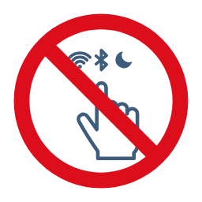

# The NoLockQS Project 🔐🚫

**Prevents access to the Quick Settings / Control Center tiles and the power menu on the lock screen of rooted Pixel phones.**

Built on the modern Xposed API (libxposed 101+); Not tied to a specific Pixel model or Android release.

## Requirements:
- Rooted Pixel running Android 15 or newer (tested on Android 15-17) 🤖
- Vector 2.2 (Minimum) 🚀

> **Android 17:** use Magisk 31.0+ and a Vector canary (3112 or newer). Magisk 30.7 and Vector 2.2 stable don't load modules on Android 17.

## 🚀 Installation

1. Download the APK from the [latest release](https://github.com/Xposed-Modules-Repo/io.github.i2B4G10.NoLockQS/releases/latest) and install it on your rooted device.
2. Open Vector, enable the module, and check the scope it asks for (System UI and System Framework).
3. Reboot, and the protection is active! If the app says **Scope incomplete**, tap the card to add what's missing.

## 📜 License

© 2026 Faisal AlDossary. All rights reserved.

NoLockQS is proprietary software: you may install and use it on your own devices, but you may not redistribute, modify or repackage it. See the [license](https://github.com/Xposed-Modules-Repo/io.github.i2B4G10.NoLockQS/blob/main/LICENSE) for the full terms.

### ❤️ You can show your love on [Patreon](https://patreon.com/Dossary)!

**Made in Saudi 🇸🇦**

