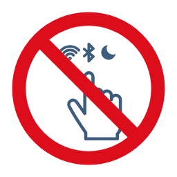
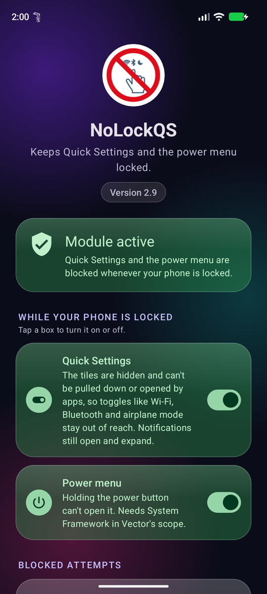
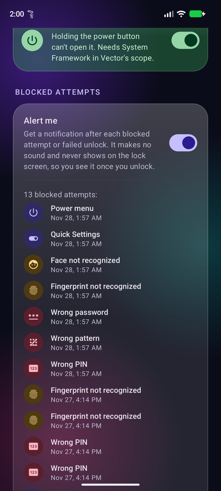
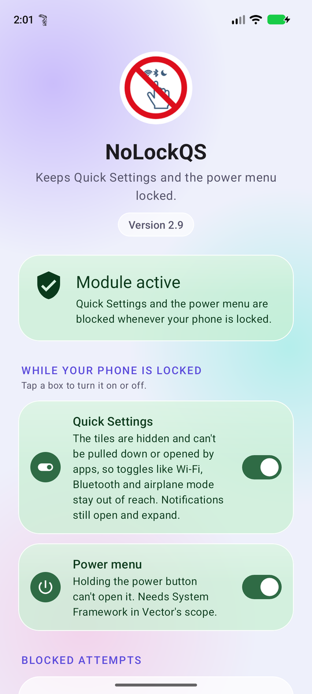
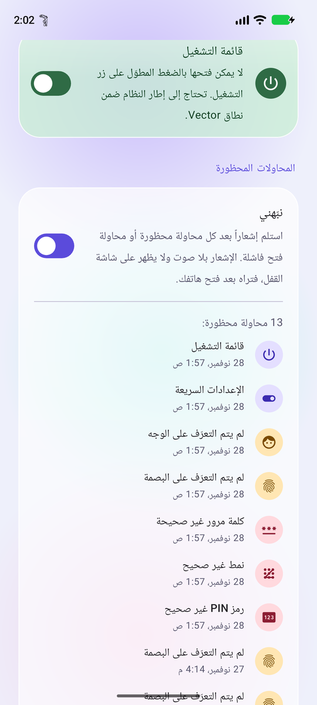

  <a href="README.ar.md">العربية</a> · <a href="README.md">English</a> · <b>简体中文</b>

# NoLockQS 项目 🔐🚫

**锁着的手机，就该一直锁着。** 
NoLockQS 会在锁屏上隐藏快捷设置和电源菜单，并在有人尝试打开时告诉你。🕵️

 

&nbsp;
&nbsp;
&nbsp;

## 🤔 为什么需要它

小偷抢到锁着的手机后，第一件事就是下拉面板：打开飞行模式、关闭移动数据、关机，然后消失得无影无踪。NoLockQS 在手机锁定时把这些门统统关上，其他一切保持原样。

## ✨ 功能一览

| | |
|---|---|
| 🧱 **锁定时没有快捷设置** | 没有图块，没有开关。通知仍然可以打开和展开。 |
| ⏻ **锁定时没有电源菜单** | 无法在锁屏上关机或重启手机。 |
| ⚡ **即时解锁** | 解锁的一瞬间一切恢复，重新锁定时同样迅速。 |
| 🔔 **提醒与记录** | 查看每一次被拦截的尝试及其时间。静默提醒会一直等到*你*解锁后才出现，小偷永远不会察觉。 |
| 🕵️ **解锁失败也会记录** | 错误的 PIN 码 🔢、图案、密码 🔑、指纹 👆 或面孔 🙂，各有专属的彩色图标。只保存时间和类型，绝不保存输入的内容。 |
| 🫧 **玻璃质感设计** | 磨砂半透明卡片，衬着柔和的光晕色彩。✨ |
| 🌓 **浅色、深色或跟随设备** | 轻点一下，立即生效。 |
| 🌍 **English · العربية · 简体中文** | 完整的从右到左阿拉伯语界面，另有简体中文。 |
| 🩺 **一键诊断** | 出现问题时，生成一份可直接分享的报告。 |
| 🔒 **注重隐私** | 没有联网权限，没有追踪。所有数据都留在你的手机上。 |

## 📋 系统要求

- 📱 一台已 Root、运行 Android 15 或更高版本的手机（已在 Android 15-17 上测试）：Pixel，或系统界面（System UI）接近原生（AOSP）的 ROM
- 🚀 Vector 2.2 或更高版本

> [!IMPORTANT]
> **Android 17** 需要 Magisk 31.0+ 和 Vector canary 版本（3112 或更高）。Magisk 30.7 和 Vector 2.2 稳定版无法在 Android 17 上加载模块。

### 🧩 其他 ROM

NoLockQS 挂钩的是原生（AOSP）系统界面，因此 ROM 越接近原生，效果越好。

| 状态 | ROM | 说明 |
|:---:|---|---|
| ✅ **已测试** |  | 一台运行 Android 17 的 Pixel，以及 Android 15、16 和 17 模拟器 |
| 🟡 **应该可用** |     | 系统界面代码与原生 Android 相同，尚未在真机上测试 |
| ❌ **不支持** |      | 它们用自己的快捷设置面板替换了原生面板，NoLockQS 很可能无法作用于它 |

用的不是 Pixel？锁定手机后试着下拉。如果面板能打开，请发送**诊断报告**。

## 🚀 安装

1. 从[最新版本](https://github.com/Xposed-Modules-Repo/io.github.i2B4G10.NoLockQS/releases/latest)下载 APK 并安装。
2. 打开 Vector，启用 **NoLockQS**，并勾选它要求的作用域：**系统界面**（System UI）和**系统框架**（System Framework）。
3. 重启。应用显示**模块已激活**，即表示保护已开启。如果显示**作用域不完整**，点按该卡片即可补上缺少的部分。
4. 应用请求通知权限时请允许，这样提醒才能送达。

> [!TIP]
> 遇到问题？打开应用，点按**故障排查 → 诊断报告**，并在反馈问题时附上它。

## 📜 许可证

© 2026 Faisal AlDossary. 保留所有权利。

NoLockQS 是专有软件：你可以在自己的设备上安装和使用它，但不得再分发、修改或重新打包。完整条款请参阅[许可证](LICENSE)。

### ❤️ 你可以在 [Patreon](https://www.patreon.com/c/Dossary) 或 [Ko-fi](https://ko-fi.com/Q8G429G7HX) 上表达你的支持！

**沙特制造 🇸🇦**

